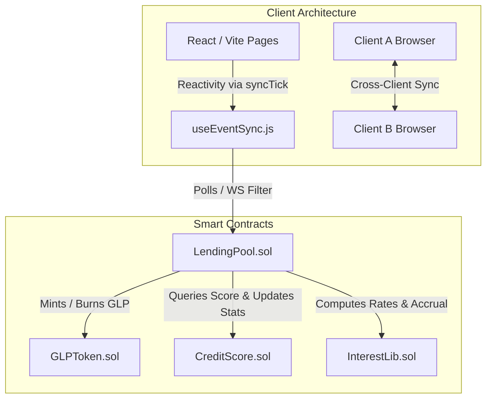

# GigLend V2 — Decentralized Micro-Lending Protocol

> A Decentralized Blockchain-Based Micro-Lending Protocol for Gig Economy Workers  
> **Team:** Poovannaraajan (23BCE0759) · Madhan Kumar (23BCB0065) · Sanjay Jaishankar (23BCB0078)

---

## 📖 Protocol Overview

GigLend V2 is a decentralized community micro-lending protocol designed for gig economy workers. The protocol connects liquidity providers (lenders) with gig workers seeking short-term uncollateralized financing. Instead of relying on traditional financial intermediaries or asset-backed collateral, borrowing limits and interest rates are dynamically determined by on-chain credit scores and protocol capital utilization.

---

## 🏗 Architecture & Module Responsibilities

The protocol consists of modular smart contracts, shared mathematical libraries, and a reactive frontend client.



### Module Responsibilities

1. **`LendingPool.sol` (Core Orchestrator)**:
   - Manages pool liquidity, lender deposits, and share redemption.
   - Enforces the **$10^6$ wei virtual-offset accounting** to neutralize ERC-4626 first-depositor share inflation attacks.
   - Originates loans with configurable tenures (7 to 90 days) and locks origination interest rates.
   - Enforces a strict **90% maximum capital utilization cap**.
   - Executes interest-first repayment waterfalls and collects a **10% insurance reserve cut** from all repaid interest.
   - Executes three-stage default settlements (**Approach A: Impairment Isolation**).
   - Manages post-default recovery, reserve replenishment, and borrower rehabilitation.

2. **`CreditScore.sol` (Risk & Reputation Engine)**:
   - Tracks on-chain repayment history, default penalties, and late repayment records.
   - Dynamically calculates user scores (scaled from 10 to 100).
   - Enforces tiered borrowing limits ($0.2\text{ ETH}$ to $5.0\text{ ETH}$) based on performance.
   - Mandates a **14-day post-default rehabilitation cooldown** before defaulted borrowers may borrow again.

3. **`GLPToken.sol` (Yield-Bearing Liquidity Token)**:
   - ERC-20 compliant pool share token.
   - Minting and burning privileges are restricted exclusively to `LendingPool`.

4. **`InterestLib.sol` (Actuarial & Interest Math)**:
   - Implements a dual-slope (kinked) borrowing rate model:
     - Base rate: $4.00\%$ APR ($400\text{ bps}$).
     - Optimal utilization breakpoint: $80.00\%$ ($8000\text{ bps}$).
     - Slope 1 (sub-optimal): $5.00\%$ ($500\text{ bps}$).
     - Slope 2 (post-optimal): $25.00\%$ ($2500\text{ bps}$).
   - Computes risk surcharges inversely proportional to borrower credit score ($0\text{ bps}$ to $400\text{ bps}$).
   - Calculates simple linear interest accrual and late surcharges ($+5.00\%$ APR).

5. **`useEventSync.js` (Reactive Frontend Synchronization)**:
   - Subscribes to blockchain logs via WebSocket or adaptive HTTP polling fallback (3-second cadence).
   - Deduplicates events using unique composite keys (`${txHash}-${logIndex}`).
   - Detects chain reorganizations and purges removed logs (`log.removed === true`).
   - Automatically triggers reactive UI updates (`syncTick`) across all connected browser clients without manual page refreshes.

---

## 🔄 Protocol Lifecycles & Financial Logic

### 1. Lender Deposit & Virtual-Offset Share Accounting
Lenders deposit ETH into the pool and receive GLP tokens representing proportional ownership of pool cash and active loan receivables:
$$\text{Shares to Mint} = \left\lfloor \frac{\text{Deposit Amount} \times (\text{Total GLP Supply} + 10^6)}{\text{Recognized Assets} + 10^6} \right\rfloor$$
Where $\text{Recognized Assets} = \text{Free Cash} + \text{Total Active Loans}$.

- **Inflation Protection**: The virtual offset ensures that an attacker depositing $1\text{ wei}$ and donating large assets cannot inflate share price to dilute subsequent depositors.
- **Zero Supply Cushion**: If total GLP share supply drops to zero while residual assets remain in the contract, subsequent depositors receive standard shares while remaining assets stay cushioned as protocol reserves without divide-by-zero errors.

### 2. Loan Origination & Utilization Cap
- **Tenure Selection**: Borrowers select repayment periods between 7 and 90 days.
- **Credit Limit Gating**: Borrowers must hold GLP tokens and cannot borrow more than their credit tier limit.
- **90% Utilization Cap**: The pool enforces that post-borrow active loans must not exceed $90.00\%$ of total capital:
  $$(\text{Active Loans} + \text{Borrow Amount}) \times 10{,}000 \le (\text{Free Cash} + \text{Active Loans}) \times 9{,}000$$
- **Rate Locking**: The combined APR (pool rate + risk surcharge) is checkpointed at origination and locked for the entire tenure.

### 3. Repayment Waterfall
Repayments follow an **interest-first, principal-second** allocation:
1. Accrued interest is settled first.
2. $10\%$ of interest collected is routed directly to the `insuranceReserve`.
3. Remaining funds reduce unpaid loan principal.
4. Any excess payment is automatically refunded to the borrower.

### 4. Default Handling, Insurance Reserve & Debt Recovery (Approach A)
If a loan remains unpaid after the due date plus a **3-day grace period**, `markDefault()` can be executed:
- **Stage 1 (Share Set-Off)**: The borrower's GLP shares are burned against their outstanding principal up to their fair share value.
- **Stage 2 (Insurance Reserve Absorption)**: If a principal balance remains, ring-fenced `insuranceReserve` funds absorb the shortfall.
- **Stage 3 (Socialized Loss & Memorandum)**: Any remaining principal and accrued interest is written off from active pool assets into an off-balance memorandum (`writtenOffDebt`), and the borrower is marked as a defaulter.
- **Debt Recovery & Rehabilitation**: Defaulters can settle their debt via `settleWrittenOffDebt()`:
  - Repayments first restore the depleted insurance reserve.
  - Remaining payments settle memorandum debt ($90\%$ returned to pool cash, $10\%$ to insurance reserve).
  - Once full debt is settled, defaulter status is cleared, subject to a **14-day rehabilitation cooldown** and score penalty.

---

## ⚙️ Reproducible Local Deployment & Setup

Follow these exact steps to run a clean local deployment from scratch.

### Prerequisites
- Node.js (v18.x or v20.x recommended)
- Git
- Web browser with MetaMask extension installed

### Step 1: Install Dependencies
```bash
# In repository root
npm install

# In frontend directory
cd frontend
npm install
cd ..
```

### Step 2: Start a Fresh Local Hardhat Node (Terminal 1)
```bash
npx hardhat node
```
This starts an Ethereum JSON-RPC node on `http://127.0.0.1:8545` with chain ID `31337` and 20 funded test accounts.

### Step 3: Deploy Smart Contracts (Terminal 2)
```bash
npx hardhat run scripts/deploy.js --network localhost
```
*What this script does:*
1. Deploys `GLPToken`, `CreditScore`, and `LendingPool`.
2. Connects contract permissions (`setLendingPool`).
3. Automatically copies compiled ABI artifacts to `frontend/src/contracts/`.
4. Updates contract addresses in `frontend/src/utils/contractHelpers.js`.

### Step 4: Configure Frontend Environment (Optional Override)
The frontend automatically uses default local addresses, but you can create a local environment file:
```bash
cd frontend
cp .env.example .env
```
Default configuration:
```env
VITE_RPC_HTTP_URL=http://127.0.0.1:8545
VITE_CHAIN_ID=31337
VITE_START_BLOCK=0
```

### Step 5: Start the Frontend Application (Terminal 2)
```bash
cd frontend
npm run dev
```
The application will launch at `http://localhost:5173`.

---

## 🦊 Local Wallet Network Configuration

Configure MetaMask to connect to your local Hardhat node:

| Parameter | Value |
| :--- | :--- |
| **Network Name** | Hardhat Localhost |
| **New RPC URL** | `http://127.0.0.1:8545` |
| **Chain ID** | `31337` |
| **Currency Symbol** | `ETH` |

### Test Accounts Setup
To test cross-client multi-user interactions, import two separate accounts from the Hardhat node output:
- **Account 0 (Deployer / Lender)**: Use the first test account generated by Hardhat.
- **Account 1 (Borrower)**: Use the second test account generated by Hardhat.

*(Do not use real funds or import mainnet accounts into the local network.)*

---

## 🧪 Comprehensive Manual Demo Checklist

This test plan validates cross-client reactivity between **Client A** (Lender / Account 0) and **Client B** (Borrower / Account 1).

### Test 1: Liquidity Deposit (Client A)
- **Action**: In Client A browser, navigate to the **Lend** page (`/app/lend`). Deposit `2.0 ETH`.
- **Expected Result**: 
  - Transaction confirms. Client A receives `2.0 GLP` shares.
  - Pool liquidity displays `2.0 ETH`.
  - In Client B browser, the **Pool** page (`/app/pool`) and **Transactions** page (`/app/transactions`) immediately show the `Deposited` event without page reload.

### Test 2: Borrower Share Requirement (Client B Pre-Condition)
- **Action**: In Client A, transfer a nominal amount (e.g. `0.05 GLP`) to Client B's address, or have Client B deposit `0.05 ETH` on the Lend page.
- **Expected Result**: Client B now holds GLP shares, unlocking borrowing eligibility.

### Test 3: Loan Origination with Tenure Selection (Client B)
- **Action**: In Client B browser, navigate to **Borrow** (`/app/borrow`). Select a `14-day` tenure and enter `0.3 ETH`.
- **Expected Result**:
  - Live preview calculates dynamic APR based on post-borrow utilization.
  - Borrower submits transaction. Wallet confirms.
  - Client B receives `0.3 ETH`. Active loan of `0.3 ETH` appears on **Loans** page (`/app/loans`).
  - Client A's dashboard reflects increased pool utilization and `Borrowed` event appears in live activity.

### Test 4: Utilization Cap Enforcement (Client B)
- **Action**: Attempt to borrow an amount that pushes pool utilization beyond $90.00\%$ (e.g., attempt to borrow `1.8 ETH`).
- **Expected Result**:
  - Frontend pre-check warns of exceeding 90% utilization cap.
  - If transaction is forced, the contract reverts with `"Utilization exceeds 90% cap"`.
  - No loan is created, and no corrupted transaction appears in the confirmed event log.

### Test 5: Loan Repayment with Excess Refund (Client B)
- **Action**: In Client B browser, navigate to **Loans** (`/app/loans`). Submit repayment with a slight overpayment (e.g. `0.35 ETH`).
- **Expected Result**:
  - Transaction confirms. Accrued interest and principal are fully settled.
  - Exact overpayment difference is refunded back to Client B's wallet.
  - $10\%$ of interest is deposited into the protocol `insuranceReserve`.
  - Loan status clears. Both clients see the `Repaid` event with principal, interest, and refund details.

### Test 6: GLP Share Withdrawal (Client A)
- **Action**: In Client A browser, go to **Lend** (`/app/lend`) and withdraw `0.5 GLP`.
- **Expected Result**:
  - Transaction confirms. `0.5 GLP` burned, corresponding ETH returned to Client A.
  - Pool total liquidity updates reactively across all clients.

### Test 7: Default Settlement & Written-Off Debt (Simulated via Hardhat Console / Test Suite)
- **Action**: When a loan remains unpaid past due date + 3 days, `markDefault(borrower)` is executed.
- **Expected Result**:
  - Borrower shares are set off against principal (Stage 1).
  - Insurance reserve absorbs shortfall (Stage 2).
  - Remaining unrecovered debt is written off to memorandum debt (Stage 3).
  - Borrower is marked as `isDefaulter = true` and credit score is penalized.
  - `DefaultSettled` event is propagated to all clients.

### Test 8: Debt Recovery & Rehabilitation
- **Action**: Defaulted borrower executes `settleWrittenOffDebt()` with required ETH.
- **Expected Result**:
  - Funds first replenish insurance reserve, then clear memorandum debt.
  - `isDefaulter` flag is cleared.
  - 14-day rehabilitation cooldown starts in `CreditScore`. Borrower cannot borrow until cooldown expires.

---

## 🔬 Test Suite Verification & Coverage

The repository includes a comprehensive 29-test automated Hardhat test suite covering financial invariants, same-block concurrency, multi-block persistence, and cross-client event synchronization.

```bash
# Run all tests
npm test
```

### Verified Test Suites
1. **`test/GigLendV2.test.js` (14 Tests)**:
   - Group 1: Virtual-offset share valuation & inflation attack resistance ($10^6\text{ wei}$ offset).
   - Group 2: Same-block utilization concurrency race (confirms first transaction succeeds, second transaction reverts with 90% cap in identical block).
   - Group 3: Sequential multi-block utilization persistence.
   - Group 4: Interest accrual, rate locking, and interest-first repayment waterfall with overpayment refunds.
   - Group 5: Default impairment waterfall (Approach A exact boundary thresholds: $415238095238093787\text{ wei}$ and $415238095238093786\text{ wei}$).
   - Group 6: Written-off debt recovery, reserve replenishment, and rehabilitation cooldown.
   - Group 7: Backward-compatible legacy `borrow(amount)` overload.

2. **`test/crossClientSync.test.js` (9 Tests)**:
   - Multi-client event propagation (deposits, borrows, repayments, withdrawals).
   - Reverted transaction isolation (failed calls do not show in confirmed activity).
   - Reconnection catch-up for offline clients.
   - Composite log deduplication (`${txHash}-${logIndex}`).
   - Account and network isolation (chain ID mismatch rejection).
   - Chain reorganization handling (`log.removed === true` purging).

3. **`test/EconomicInvariants.test.js` (6 Tests)**:
   - Virtual-offset behavior when share supply returns to zero after inflation attack.
   - Dust deposit rejection when large residual assets exist with zero shares.
   - Liquidity withdrawal invariant (cannot withdraw more than free cash).
   - Simultaneous borrowing and 90% utilization cap enforcement across multiple borrowers.
   - Complete lifecycle invariant validation (deposit → borrow → interest → repay → reserve).
   - Default settlement with complete reserve depletion and subsequent full recovery.

---

## ⚠️ Protocol Limitations & Production Boundaries

To maintain rigorous engineering integrity, the following boundaries and limitations are explicitly noted:

1. **Credit Scoring & Income Attestation**:
   - The current `CreditScore.sol` contract calculates scores based on internal on-chain repayment history and simulated income (`simulatedIncome = 1000`).
   - Production deployment requires integration with off-chain decentralized oracle networks (e.g. Chainlink Functions, TLSNotary, or zkTLS) to cryptographically verify real-world gig platform earnings.

2. **Interest Accrual Model**:
   - Interest accrues using simple annualized linear interest rather than continuous compound interest.
   - Rates are locked at origination and do not adjust dynamically for existing loans as pool utilization changes.

3. **Single Asset Liquidity**:
   - The pool natively operates on native ETH. It does not support ERC-20 stablecoins (e.g., USDC, USDT), which would reduce exchange-rate volatility risk for gig workers.

4. **Network & Consensus Assumptions**:
   - Event synchronization and same-block concurrency tests were verified using the local Hardhat EVM environment (`chainId: 31337`).
   - Deep multi-block reorganizations (>5 blocks), high network latency, and public mempool frontrunning dynamics have not been evaluated under live public mainnet conditions.

---

## 👥 Team Contributions

- **Poovannaraajan (23BCE0759):** Smart Contracts (`LendingPool.sol`, `GLPToken.sol`, `InterestLib.sol`), mathematical modeling of virtual offsets, Hardhat test suites.
- **Madhan Kumar (23BCB0065):** Frontend Architecture (React + Vite), UI components, Ethers.js integration, cross-client event synchronization (`useEventSync.js`).
- **Sanjay Jaishankar (23BCB0078):** Credit Scoring Engine (`CreditScore.sol`), default settlement waterfall (Approach A), risk modeling, unit test coverage.
